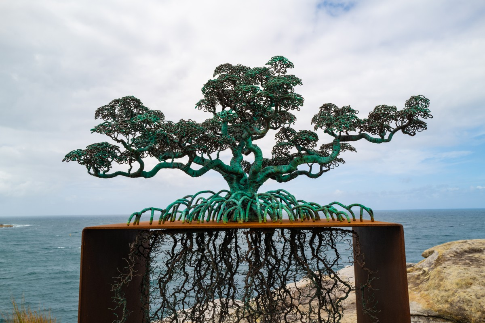
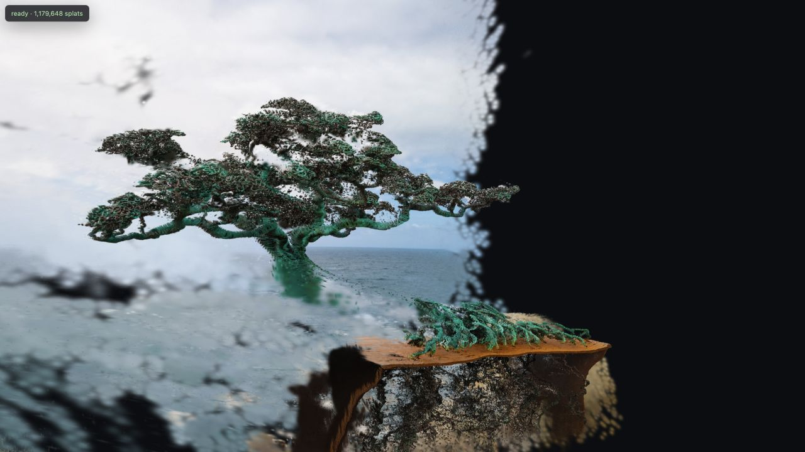
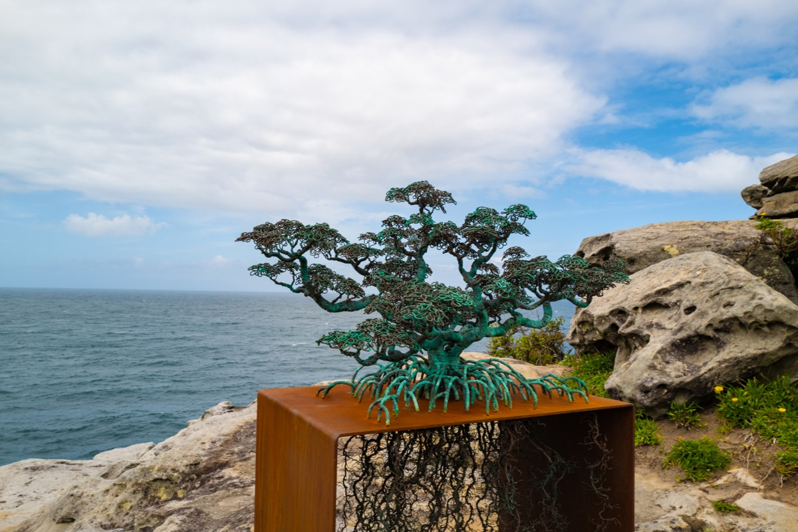
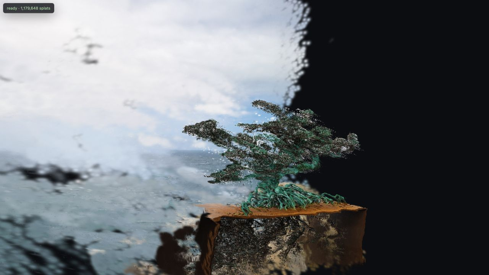

# DoubleSHARP

An experimental two-photo depth-conditioning pipeline for [Apple SHARP](https://github.com/apple/ml-sharp), running locally on Apple Silicon.

## Start with one photograph

SHARP turns a single photograph into a Gaussian splat. For this experiment, we started with this wire tree sculpture by the sea.

[](examples/tree/2026_10_L1101215.jpg)

From the original camera position, the reconstruction looked convincing. Moving the camera revealed a problem.

## The tree comes apart

SHARP estimated much of the canopy too far behind the pedestal. From another viewpoint, the trunk appears disconnected from its roots, and the canopy floats away from the base.



The first photo alone leaves ambiguity about how the branches, trunk and pedestal fit together in depth.

## Add a second photograph

A second view gives us more evidence about that geometry.

[](examples/tree/2026_10_L1101219.jpg)

[Depth Anything 3](https://github.com/ByteDance-Seed/Depth-Anything-3) processes both photographs together to estimate depth and their relative camera poses. DoubleSHARP uses that joint depth estimate to guide a fresh SHARP reconstruction.

## Rebuild with the two-view depth

DoubleSHARP supplies the depth to SHARP **before Gaussian initialization**, then reruns its learned Gaussian prediction. SHARP's image features still come from the first photograph.



The canopy now sits closer to the pedestal, reducing the visible separation. Fine branch structure is retained, while floaters and incomplete surfaces remain visible.

Both splat screenshots use exactly the same camera: the second photograph's complete pose and intrinsics, estimated by DA3. They are unretouched WebGL captures. This is one qualitative example with no independently calibrated camera or depth ground truth; the second photograph is an input to the depth model, so this is not a held-out-view test.

Both full-resolution **8368 × 5584** source JPEGs are included in [examples/tree](examples/tree). Location and device-serial metadata have been removed from the published copies. Decoded image pixels and the focal-length metadata used by SHARP are preserved.

## Run locally

Tested on an Apple M4 Pro with 48 GB unified memory, Python 3.12, and PyTorch MPS. Install [uv](https://docs.astral.sh/uv/getting-started/installation/), Git, and Apple's command-line tools, then:

```bash
git clone https://github.com/bgunsberger/DoubleSHARP.git
cd DoubleSHARP
./setup-sharp-multiview.sh
./run-doublesharp.sh \
  examples/tree/2026_10_L1101215.jpg \
  examples/tree/2026_10_L1101219.jpg
./preview.sh
```

Open [the local comparison](http://127.0.0.1:8873/web/sharp-conditioned-comparison.html). Choose **Second photo camera** to reproduce the illustrated viewpoint. The [second-camera permalink](http://127.0.0.1:8873/web/sharp-conditioned-comparison.html?camera=second) also restores that camera.

Setup clones pinned upstream sources and installs the Python environment. The first inference downloads roughly 7.5 GB of SHARP and DA3 Giant checkpoints from their publishers. Neural inference runs on MPS. The WebGL preview runs in the browser. Input photographs stay local during reconstruction.

For your own experiment, replace the two file arguments with overlapping photographs of a static scene. The pedestal-based scale anchor is specific to this example; adapt `scripts/multiview_prior.py` for different framing or subjects.

Outputs are written under `output/sharp-multiview/`, including baseline and conditioned PLY/`.splat` files, reusable tensors, DA3 depth/pose predictions, and a reconstruction report. Running again replaces those experiment outputs. Generated scene files and checkpoints are excluded from this repository.

## How it works

1. Predict baseline SHARP geometry from the reference image and retain its depth estimate for scale anchoring.
2. Run DA3 Giant jointly on both images, at 504 × 336 per view, to estimate depth, confidence and relative camera poses.
3. Filter pedestal pixels using confidence and cross-view depth consistency, then estimate one global scale between DA3 and SHARP depth.
4. Pass the full-frame scaled depth into SHARP's existing `depth=` argument. Its learned alignment module determines the depth reaching Gaussian initialization.
5. Rerun the feature network, Gaussian prediction head, and composer; export the newly predicted scene.

This is inference-time integration of released models. It uses their existing learned weights. See [the method and measurements](docs/method.md) and [the example provenance](examples/tree/provenance.json).

## License

Original DoubleSHARP code is **Apache 2.0**. The complete pipeline has separate model restrictions: **SHARP's checkpoint is restricted to noncommercial scientific research and excludes product development**, and **DA3 Giant is CC BY-NC 4.0**. The code license does not expand those model permissions. See [THIRD_PARTY.md](THIRD_PARTY.md), [NOTICE](NOTICE), and [licenses](licenses).

The example photographs and rendered screenshots are excluded from the source-code license. This is an independent research experiment using Apple SHARP and ByteDance's Depth Anything 3.
